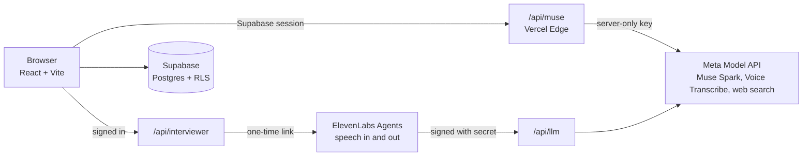

# Ropi

**Turn your dead time into growth time.**

**Live app: [rop-i.vercel.app](https://rop-i.vercel.app/)** · Built for the Meta Global AI Developer Hackathon 2026 with Meta's Muse models.

Ropi is a study and career coach for people who are learning and job hunting around a full life: shift workers, career changers, people who just moved countries. They don't get free evenings. They get 5 minutes on the platform and 20 on the bus. Ropi turns those minutes into progress, plans the bigger work into the free time they actually have, and replans when the week changes.

## Try it in two minutes

No account is needed. Ropi signs you in anonymously.

1. Open **[rop-i.vercel.app](https://rop-i.vercel.app/)**, click **Try it free**, type your name, then click **Load a sample week**.
2. **Today:** under **Got a few minutes?**, pick 5 minutes. Ropi offers up to three things that fit, taken from your own data.
3. **Talk:** type or say *"I have 10 minutes on the train"*, then *"start"*.
4. **Practice:** choose **Live, out loud** for a spoken mock interview that follows up on what you actually said. When you end it, the review quotes your own words.
5. **More > When life changes:** type *"manager added a shift, only 20 min tonight"*. Only the blocks that lost their time move, and each one says why.

## What it does

| | |
|---|---|
| **Today** | Today's plan as one short list with **Start** on the first item, **Got a few minutes?** for 2 to 20 minute gaps (with an audio-only option), **Hear my day** read aloud, and the week calendar. |
| **Talk** | A hands-free coach. It explains a concept, quizzes you, gives the latest news with dated sources, finds a podcast that fits your commute, adds tasks to your week, searches jobs, and drafts form answers. Every conversation is saved and filed under its topic. |
| **Learn** | Type a topic to get a quiz or a study guide with cards, or upload a PDF or DOCX to get a quiz where every answer quotes its line. Each topic has a folder with subtopics, notes, missed questions and free resources found on the live web. Missed questions become spaced-repetition cards. |
| **Practice** | A speaking studio for the role you want: a live spoken interview, or a single recorded answer with camera feedback. The review covers what worked, a stronger version built only from your own facts, and pace, filler words and pauses measured from the recording. |
| **Jobs** | One search across five job sources. Save a job, score your resume against it, tailor the resume, then apply yourself. A board shows every job by stage. |
| **More** | **Your CV**: edit it, tailor it to a job, download a PDF or Word file. **When life changes**: replan from one sentence, with undo. **Tasks**: everything on your plate this week. **History**: everything you did, day by day. |

Press **Ctrl/Cmd + K** anywhere to ask about your own progress ("What have I been getting wrong?"). Answers cite your own records.

## How Meta Muse is used

| Job | Muse feature | Where |
|---|---|---|
| Turning sentences into structured data (free time, life changes) | Muse Spark 1.3, JSON output | `lib/week/parse-availability.ts`, `lib/scheduling/parse-constraint.ts` |
| Quizzes on any topic and from your documents, lessons on your weakest concept | Muse Spark 1.3, streamed | `lib/learning/topic-quiz.ts`, `source-quiz.ts`, `adaptive-lessons.ts` |
| Talk: intent, explanations, coaching, notes, career paths | Muse Spark 1.3 | `lib/coach/brain.ts` |
| Latest news and free resources with real links | Responses API with `web_search` (search grounding) | `lib/api/muse.ts`, `lib/library/find-resources.ts` |
| Live interviewer's brain | Muse Spark 1.3, streamed through Ropi's own endpoint | `api/llm.ts` |
| Interview review from transcript, measured numbers and 6 camera frames | Muse Spark image understanding | `lib/interview/studio.ts` |
| Transcribing your practice answer | Muse Voice Transcribe 1.0 | `lib/voice/muse-listen.ts` |
| CV parsing and tailoring, resume tailoring, document summaries | Muse Spark 1.3 | `lib/cv/`, `lib/jobs/` |

Some parts are deliberately not a model, so they stay predictable and checkable:
- **Scheduling** is a constraint scheduler. Replan explanations come from its data.
- **Got a few minutes?** is a small set of rules that never plans more minutes than you picked.
- **Review timing** is FSRS (`ts-fsrs`). It brings a card back just before you'd forget it.
- **Resume scoring** is deterministic: key terms, skills, title, sections and gaps.
- **Delivery numbers** (words a minute, filler words, pauses) are counted, not guessed.

## Built to be trusted

These rules are enforced in code:
- **Document quizzes keep only questions whose quote is word for word in your file** (`quoteIsInChunk`).
- **Ask Ropi drops citations to evidence that doesn't exist** (`verifyCitations`).
- **Tailoring can't invent experience.** Any CV bullet that gains a new number is put back.
- **Resources and news show only links the search actually returned.**
- **Ropi never applies for you.** "Applied" is something you report.
- **The interview review never guesses your feelings.** Camera notes cover eye line, posture, light and framing only.
- **History is append-only.** Row-level security allows inserts and reads, never edits.

## Architecture



- **No keys in the browser.** The Meta key lives only on the server. `/api/muse` checks the caller's Supabase session, allows only the five endpoints Ropi uses, and caps body size.
- **The live interviewer** uses ElevenLabs for listening, turn-taking and voice, with Muse Spark as the brain. ElevenLabs calls `/api/llm`, which accepts only calls signed with Ropi's secret, removes the fields Meta rejects, and streams Muse's reply. The reply text starts about 150 ms after your words are transcribed.
- **Data** is in Supabase with row-level security on every table (`auth.uid() = user_id`). An audit as an outside visitor read 0 rows from all 33 tables.

## Known limits

- Sign-in is anonymous, so the model proxy checks for a Ropi session, not a paid account. It needs rate limits before a wide launch.
- Your week and CV draft are saved in your browser. Quizzes, cards, jobs, documents and History are in Supabase. There's no cross-device sync yet.
- Nothing runs in the background, so there are no notifications.
- On the live site, Talk listens with the browser's own speech recognition (Chrome, Edge or Safari), because Muse's realtime listening needs the key in the browser. Practice recordings are transcribed by Muse on the server, up to about 2 minutes.
- Job descriptions are fetched automatically only for Job Seek listings. For other jobs you paste the description.

## Run it yourself

You need Node 20.19+ (or 22.12+), a Supabase project and a Meta Model API key. The live interviewer also needs an ElevenLabs account.

```bash
npm install
cp .env.example .env   # fill in the values
npm run dev            # http://localhost:5173
```

| Variable | Where | What it is |
|---|---|---|
| `VITE_SUPABASE_URL`, `VITE_SUPABASE_ANON_KEY` | browser | Supabase project URL and publishable key (public by design) |
| `MUSE_API_KEY` | server | Meta Model API key (deployed) |
| `VITE_MUSE_API_KEY` | browser | Meta key for **local development only**. Leave it out of any deployment |
| `ELEVENLABS_API_KEY`, `ELEVENLABS_AGENT_ID` | server | Live interviewer (optional) |
| `ROPI_LLM_SECRET` | server | Secret the ElevenLabs agent signs its calls to `/api/llm` with |

Database: in the Supabase SQL editor, run `supabase-schema.sql`, then each file in `supabase-migrations/` in filename order. Each one is safe to re-run. Then turn on anonymous sign-ins (Authentication > Providers).

**Deploy to Vercel:** import the repo (`vercel.json` sets the routes), add the variables above, and deploy. Then add the Vercel URL in Supabase (Authentication > URL Configuration), and set the ElevenLabs agent's custom LLM URL to `https://<your-domain>/api/llm`. Never add a `VITE_` prefix to a key, because anything named `VITE_*` is built into the page.

## Credits

Code adapted from open-source projects is listed, with each licence, in [`THIRD_PARTY_NOTICES.md`](THIRD_PARTY_NOTICES.md).

Job listings come from [Job Seek](https://jseek.co): Viktor Shcherbakov, "Collection of Job Postings," (c) 2025, [CC BY-NC 4.0](https://creativecommons.org/licenses/by-nc/4.0/). Job descriptions belong to the employers.
